# Appointment Service

Microservice 2 du projet SmartCare, responsable de la gestion des rendez-vous médicaux

**Équipe : TuniTech (DAS11-G4)**
- Lyna Moujahed
- Mouhamed Ayoub Hajri
- Ayoub Maatoug
- Tenkwa Njanda P

# Objectif
Développer le microservice de gestion des rendez-vous médicaux pour Smart Hospital.

# Fonctionnalités
- [ ] Ajouter un rendez-vous
- [ ] Afficher la liste des rendez-vous
- [ ] Rechercher un rendez-vous
- [ ] Modifier un rendez-vous
- [ ] Annuler un rendez-vous
- [ ] Vérifier la disponibilité des médecins
- [ ] Associer un rendez-vous à un patient et à un médecin
- [ ] Gérer les statuts des rendez-vous
- [ ] Créer les API REST
- [ ] Configurer la base de données
- [ ] Tester les endpoints

---

# Atelier 1 : Serveur Eureka

## Architecture

| Service | Technologie | Port | Nom dans Eureka |
|---|---|---|---|
| Eureka Server (`Backend/eureka-server`) | Spring Boot 3.5.6 | 8761 | aucun |
| Appointment Service | Spring Boot 3.5.6 + MongoDB | 8085 | APPOINTMENT-SERVICE |

Le service s'enregistre auprès d'Eureka grâce à `@EnableDiscoveryClient` et à la dépendance
`spring-cloud-starter-netflix-eureka-client` (Spring Cloud 2025.0.0).

## Configuration (`application.properties`)

```properties
spring.application.name=appointment-service
server.port=8085
eureka.client.service-url.defaultZone=http://localhost:8761/eureka
eureka.client.register-with-eureka=true
eureka.client.fetch-registry=true
eureka.instance.prefer-ip-address=true
```

## Plusieurs instances

Une deuxième instance est lancée sur le port 8095 (`-Dserver.port=8095`).
Les deux instances partagent la même base MongoDB (`appointment_db`).


---

# Atelier 2 : Observabilité avec Spring Boot Actuator

## Configuration

```properties
management.endpoints.web.exposure.include=health,info,metrics
management.endpoint.health.show-details=always
eureka.client.healthcheck.enabled=true
management.info.env.enabled=true
info.app.name=appointment-service
info.app.version=1.0.0
info.app.description=Microservice de gestion des rendez-vous
info.app.team=TuniTech
```

## `/actuator/health`

Statut UP, avec le composant `mongo` :

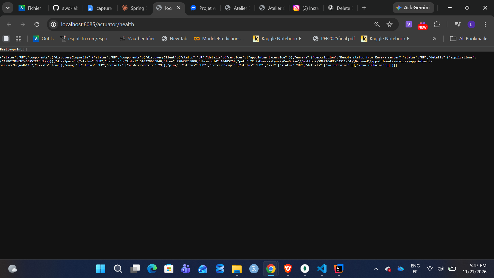

## `/actuator/info`

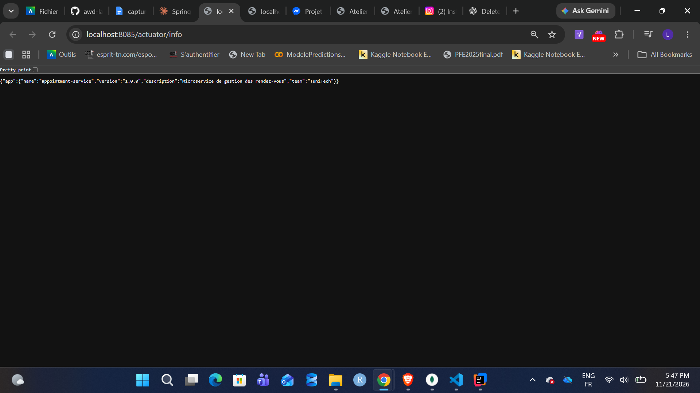

## `/actuator/metrics`

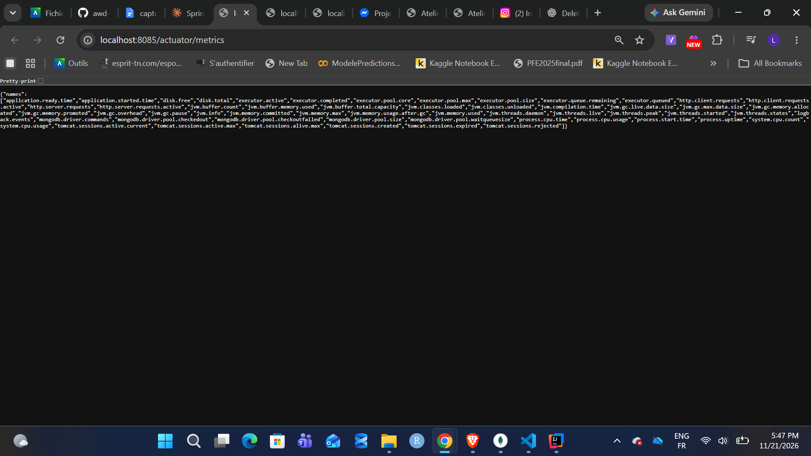

## Panne de la base de données

MongoDB a été arrêté. Le service passe **DOWN** (le composant `mongo` signale une erreur
de connexion) et Eureka reçoit ce statut grâce à `eureka.client.healthcheck.enabled=true`.


Après le redémarrage de MongoDB, le service repasse **UP** :

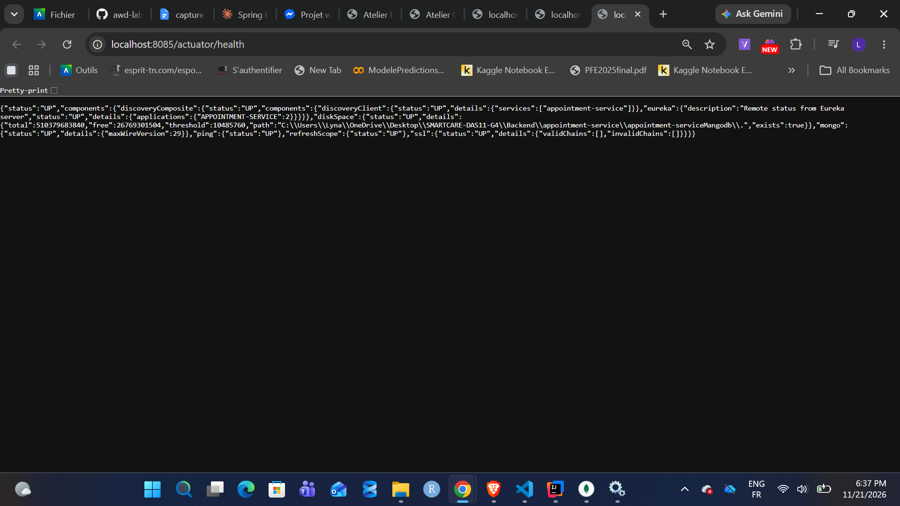

## Métriques `http.server.requests`

| Mesure | Toutes les requêtes | `?tag=status:200` |
|---|---|---|
| COUNT | 8 | 7 |
| TOTAL_TIME | 30,29 s | 0,387 s |
| MAX | 0,0 s (fenêtre déjà réinitialisée) | 0,1665 s |

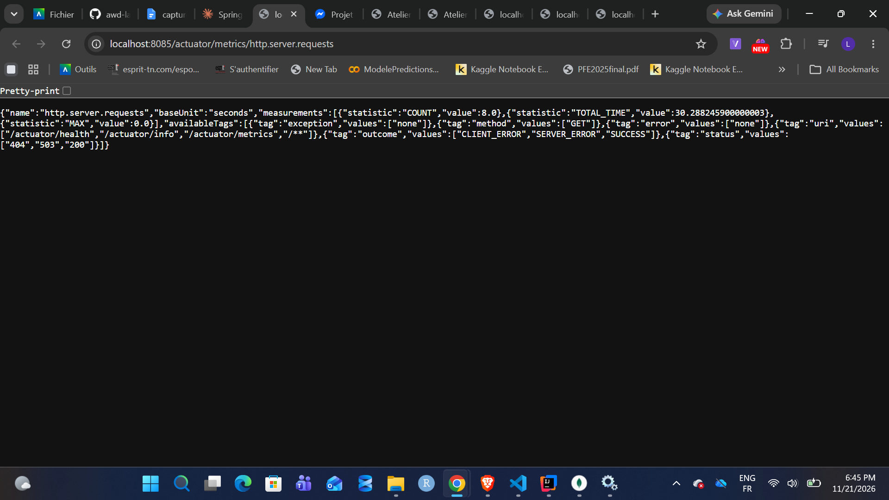


**Réponse à la question de l'atelier :** le service a traité **8 requêtes** au total.
La requête réussie la plus lente a duré environ **0,17 s** (MAX). Le filtre `status:200`
ne compte que les requêtes réussies : **7**. La différence correspond à la réponse **503**
de `/actuator/health` pendant l'arrêt de MongoDB (qui explique aussi les 30 s de
TOTAL_TIME, le temps d'attente du timeout) et à une réponse **404** sur une URL inconnue.

---

# Atelier 3 : API Gateway (configuration dynamique) et Circuit Breaker

## Architecture

| Service | Technologie | Port | Nom dans Eureka |
|---|---|---|---|
| Eureka Server (`Backend/eureka-server`) | Spring Boot 3.5.6 | 8761 | aucun |
| API Gateway (`Backend/gateway`) | Spring Cloud Gateway Server MVC | 8080 | SMARTCARE-API-GATEWAY |
| Appointment Service | Spring Boot 3.5.6 + MongoDB | 8085 et 8086 | APPOINTMENT-SERVICE |

La Gateway est le point d'entrée unique du projet. Elle s'enregistre auprès d'Eureka et
route les requêtes vers les microservices **par leur nom de service** (`lb://...`), sans
connaître leur adresse ni leur port.

## Endpoints exposés par le service

| Méthode | URL (via la Gateway) | Description |
|---|---|---|
| GET | `/api/appointments` | Liste des rendez-vous |
| GET | `/api/appointments/{id}` | Détail d'un rendez-vous |
| POST | `/api/appointments` | Création d'un rendez-vous |
| GET | `/api/appointments/instance` | Port de l'instance qui répond (test du load balancing) |

## 1. Routage dynamique

La Gateway utilise le profil `dynamic` par défaut (`GATEWAY_PROFILE`). La route du service
(`application-dynamic.properties`) :

```properties
spring.cloud.gateway.server.webmvc.routes[1].id=appointment-service
spring.cloud.gateway.server.webmvc.routes[1].uri=lb://APPOINTMENT-SERVICE
spring.cloud.gateway.server.webmvc.routes[1].predicates[0]=Path=/api/appointments/**,/api/appointments
```

La Gateway et le service sont enregistrés dans Eureka :

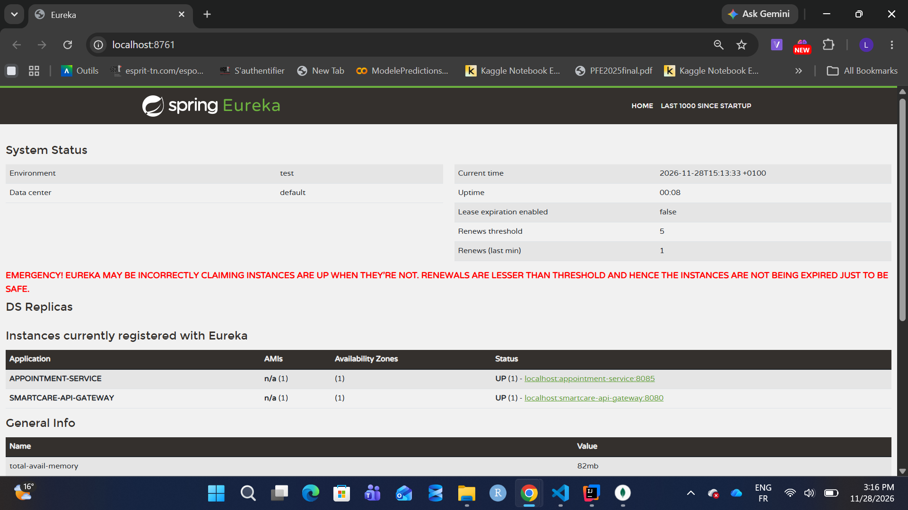

Même réponse en appelant directement le service (port 8085) et via la Gateway (port 8080) :

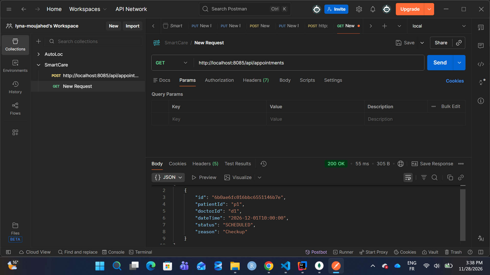

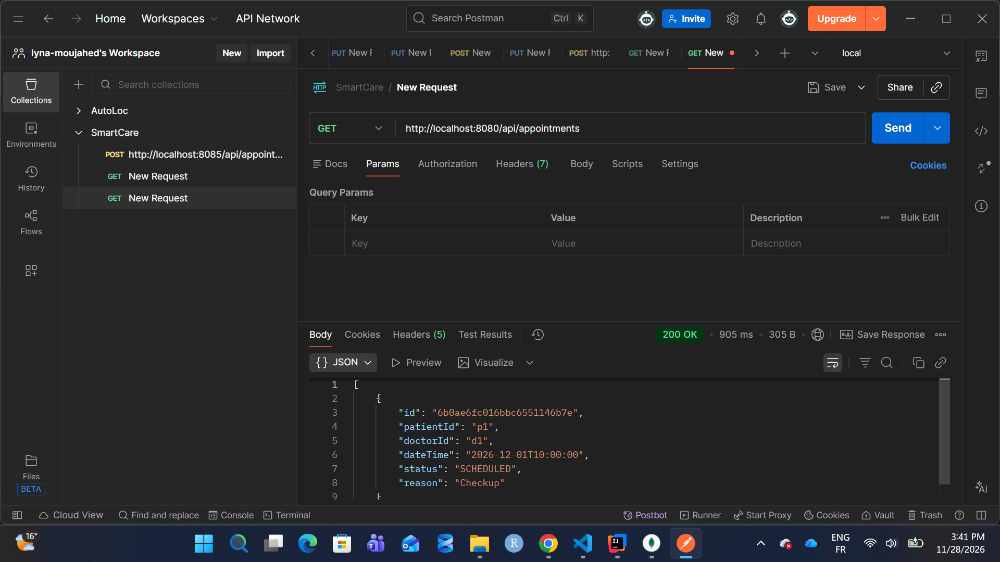

## 2. Load balancing

Deux instances du service (ports 8085 et 8086, la seconde lancée avec `-Dserver.port=8086`)
sont enregistrées sous le même nom `APPOINTMENT-SERVICE` :

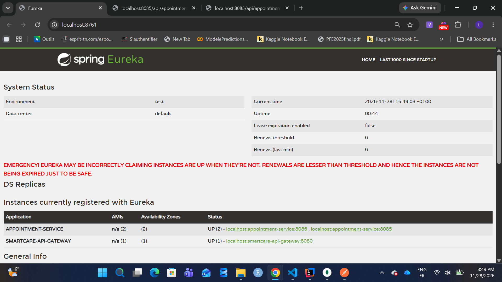

En appelant `GET http://localhost:8080/api/appointments/instance` plusieurs fois via la
Gateway, les ports alternent entre les deux instances. C'est la stratégie par défaut de
Spring Cloud LoadBalancer, **Round Robin** :

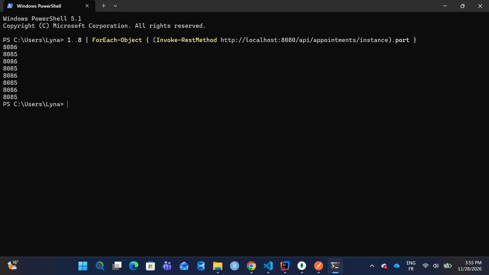

## 3. Circuit Breaker (Resilience4j)

### Configuration

Dépendance ajoutée à la Gateway (version MVC, pas la version `reactor`) :

```xml
<dependency>
    <groupId>org.springframework.cloud</groupId>
    <artifactId>spring-cloud-starter-circuitbreaker-resilience4j</artifactId>
</dependency>
```

Filtre `CircuitBreaker` sur la route du service (`application-dynamic.properties`) :

```properties
spring.cloud.gateway.server.webmvc.routes[1].filters[0].name=CircuitBreaker
spring.cloud.gateway.server.webmvc.routes[1].filters[0].args.id=appointmentCB
spring.cloud.gateway.server.webmvc.routes[1].filters[0].args.fallbackUri=forward:/fallback/appointments
spring.cloud.gateway.server.webmvc.routes[1].filters[0].args.statusCodes=500,502,503,504
```

Paramètres Resilience4j (`application.properties` de la Gateway) :

```properties
resilience4j.circuitbreaker.instances.appointmentCB.sliding-window-size=5
resilience4j.circuitbreaker.instances.appointmentCB.minimum-number-of-calls=3
resilience4j.circuitbreaker.instances.appointmentCB.failure-rate-threshold=50
resilience4j.circuitbreaker.instances.appointmentCB.wait-duration-in-open-state=30s
resilience4j.circuitbreaker.instances.appointmentCB.permitted-number-of-calls-in-half-open-state=2
resilience4j.circuitbreaker.instances.appointmentCB.automatic-transition-from-open-to-half-open-enabled=true
resilience4j.circuitbreaker.instances.appointmentCB.register-health-indicator=true
management.health.circuitbreakers.enabled=true
```

| Paramètre | Valeur |
|---|---|
| sliding-window-size | 5 |
| minimum-number-of-calls | 3 |
| failure-rate-threshold | 50 % |
| wait-duration-in-open-state | 30 s |
| permitted-number-of-calls-in-half-open-state | 2 |

### Fallback

Si le service est indisponible, la Gateway répond avec le contrôleur de repli
`FallbackController` (`/fallback/appointments`) :

```json
{"message": "Appointment service is temporarily unavailable", "degraded": true}
```

### Test

L'état du circuit est visible dans `http://localhost:8080/actuator/health`.

**État normal (CLOSED)** : les instances sont démarrées, les requêtes passent.

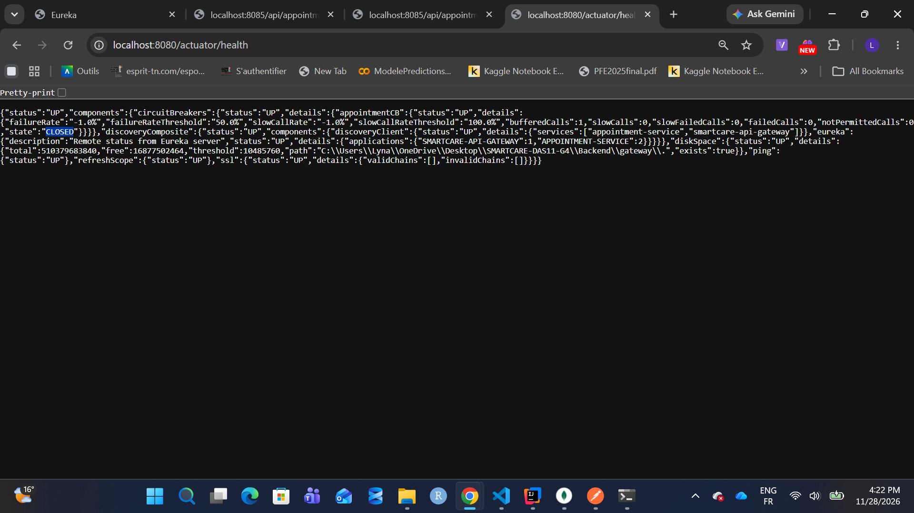

**Indisponibilité** : les deux instances du service sont arrêtées. Les requêtes reçoivent
la réponse de repli au lieu d'une erreur :

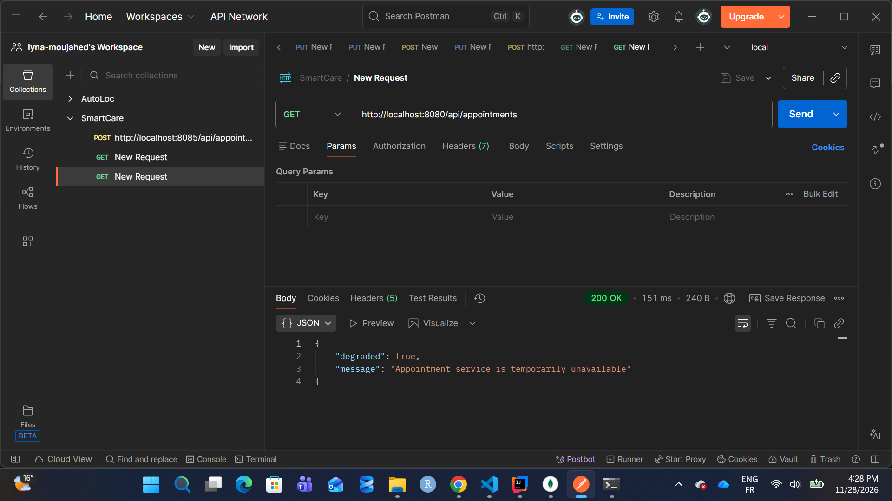

**Circuit OPEN** : après plusieurs échecs (taux d'échec supérieur à 50 %), le circuit
s'ouvre et les appels suivants ne sont plus transmis au service :

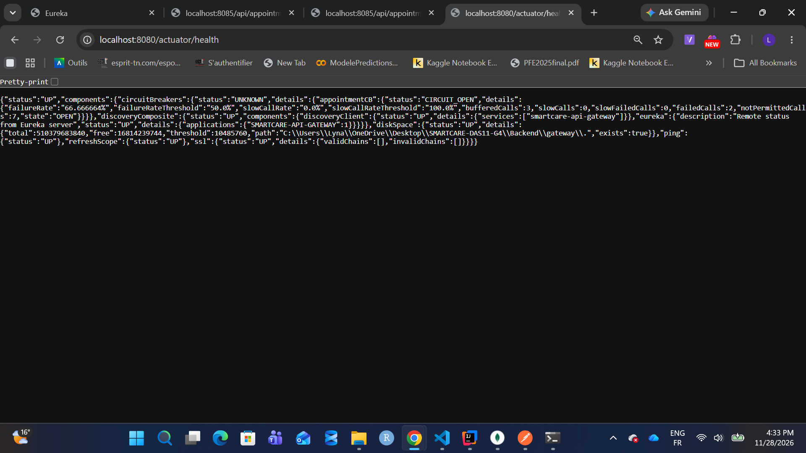

**Récupération** : une instance est redémarrée. Après le délai d'attente (30 s), le circuit
passe en HALF_OPEN puis revient à CLOSED après 2 appels réussis :

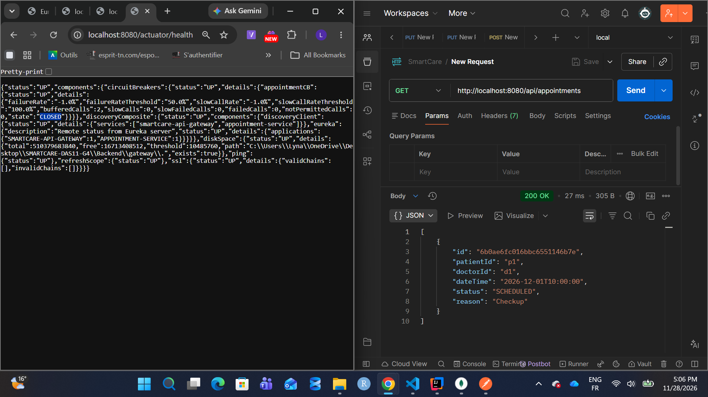

---

## Ordre de démarrage

1. MongoDB
2. Eureka Server (8761)
3. Appointment Service (8085, puis une deuxième instance)
4. API Gateway (8080)