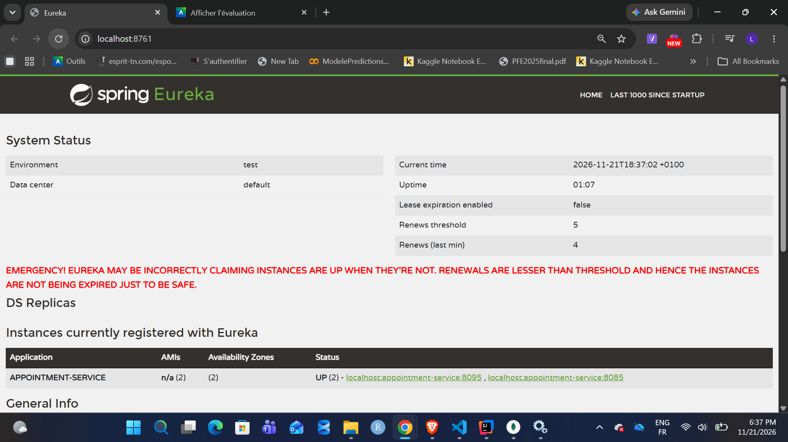
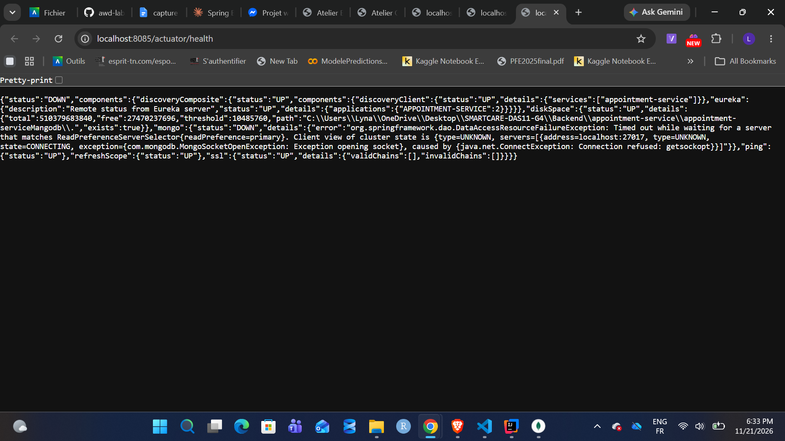
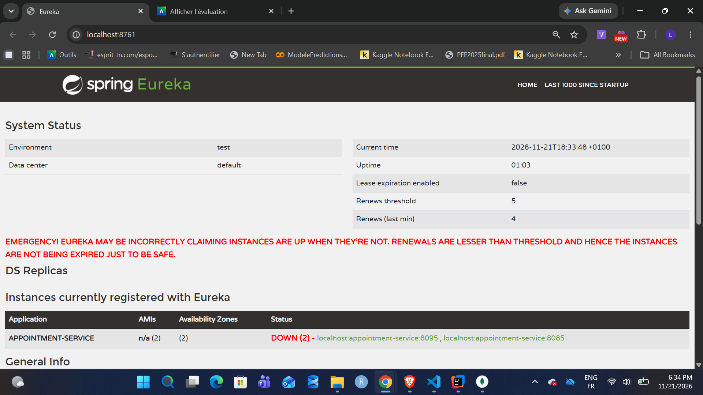
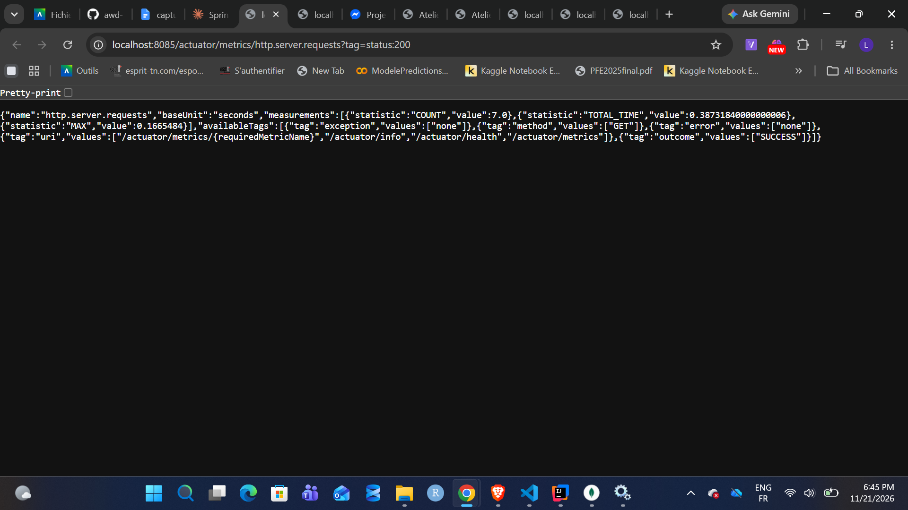

# Appointment Service

Microservice 2 du projet SmartCare, responsable de la gestion des rendez-vous médicaux

**Équipe : TuniTech (DAS11-G4)**
- Lyna Moujahed
- Mouhamed Ayoub Hajri
- Ayoub Maatoug
- Tenkwa Njanda P

# Objectif
Développer le microservice de gestion des rendez-vous médicaux pour Smart Hospital.

# Fonctionnalités
- [ ] Ajouter un rendez-vous
- [ ] Afficher la liste des rendez-vous
- [ ] Rechercher un rendez-vous
- [ ] Modifier un rendez-vous
- [ ] Annuler un rendez-vous
- [ ] Vérifier la disponibilité des médecins
- [ ] Associer un rendez-vous à un patient et à un médecin
- [ ] Gérer les statuts des rendez-vous
- [ ] Créer les API REST
- [ ] Configurer la base de données
- [ ] Tester les endpoints

---

# Atelier 1 : Serveur Eureka

## Architecture

| Service | Technologie | Port | Nom dans Eureka |
|---|---|---|---|
| Eureka Server (`Backend/eureka-server`) | Spring Boot 3.5.6 | 8761 | aucun |
| Appointment Service | Spring Boot 3.5.6 + MongoDB | 8085 | APPOINTMENT-SERVICE |

Le service s'enregistre auprès d'Eureka grâce à `@EnableDiscoveryClient` et à la dépendance
`spring-cloud-starter-netflix-eureka-client` (Spring Cloud 2025.0.0).

## Configuration (`application.properties`)

```properties
spring.application.name=appointment-service
server.port=8085
eureka.client.service-url.defaultZone=http://localhost:8761/eureka
eureka.client.register-with-eureka=true
eureka.client.fetch-registry=true
eureka.instance.prefer-ip-address=true
```

## Plusieurs instances

Une deuxième instance est lancée sur le port 8095 (`-Dserver.port=8095`).
Les deux instances partagent la même base MongoDB (`appointment_db`).



---

# Atelier 2 : Observabilité avec Spring Boot Actuator

## Configuration

```properties
management.endpoints.web.exposure.include=health,info,metrics
management.endpoint.health.show-details=always
eureka.client.healthcheck.enabled=true
management.info.env.enabled=true
info.app.name=appointment-service
info.app.version=1.0.0
info.app.description=Microservice de gestion des rendez-vous
info.app.team=TuniTech
```

## `/actuator/health`

Statut UP, avec le composant `mongo` :


## `/actuator/info`


## `/actuator/metrics`


## Panne de la base de données

MongoDB a été arrêté. Le service passe **DOWN** (le composant `mongo` signale une erreur
de connexion) et Eureka reçoit ce statut grâce à `eureka.client.healthcheck.enabled=true`.





Après le redémarrage de MongoDB, le service repasse **UP** :


## Métriques `http.server.requests`

| Mesure | Toutes les requêtes | `?tag=status:200` |
|---|---|---|
| COUNT | 8 | 7 |
| TOTAL_TIME | 30,29 s | 0,387 s |
| MAX | 0,0 s (fenêtre déjà réinitialisée) | 0,1665 s |




**Réponse à la question de l'atelier :** le service a traité **8 requêtes** au total.
La requête réussie la plus lente a duré environ **0,17 s** (MAX). Le filtre `status:200`
ne compte que les requêtes réussies : **7**. La différence correspond à la réponse **503**
de `/actuator/health` pendant l'arrêt de MongoDB (qui explique aussi les 30 s de
TOTAL_TIME, le temps d'attente du timeout) et à une réponse **404** sur une URL inconnue.

## Ordre de démarrage

1. MongoDB
2. Eureka Server (8761)
3. Appointment Service (8085, puis 8095)