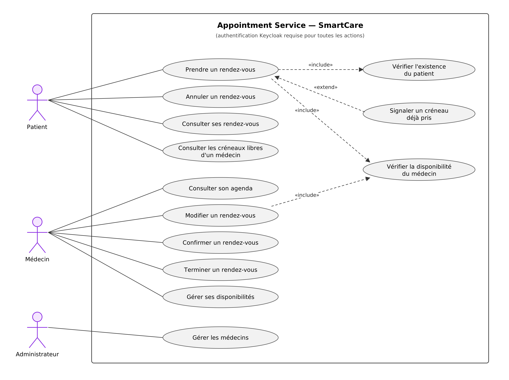
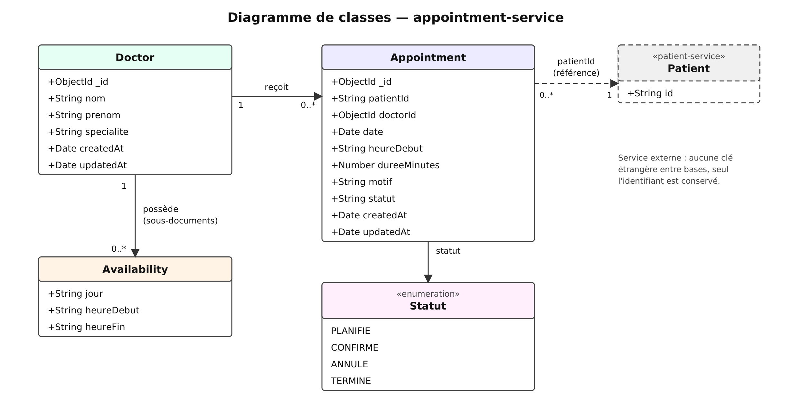
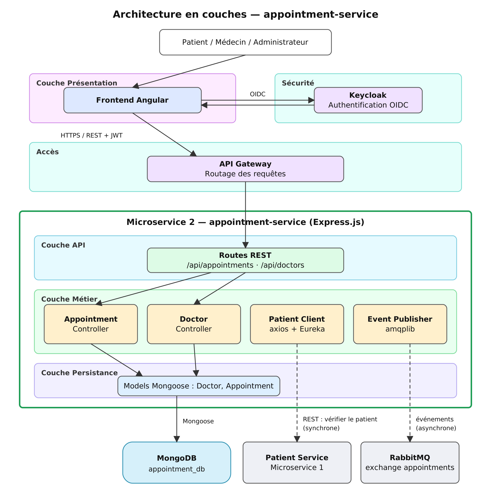
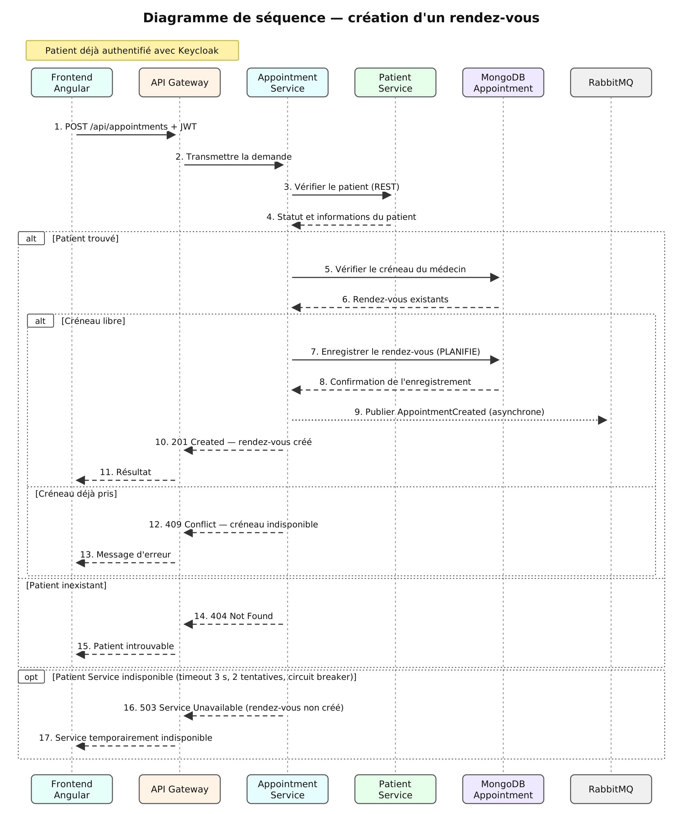

# Diagrammes : appointment-service

Microservice 2 du projet SmartCare (Smart Hospital), développé en Express.js avec MongoDB. Il gère la planification des rendez-vous médicaux : rendez-vous, médecins et disponibilités.

## 1. Cas d'utilisation : `fig-usecase.png`

Trois acteurs, tous authentifiés par Keycloak : le patient (prendre, annuler et consulter ses rendez-vous, consulter les créneaux libres), le médecin (gérer son agenda et ses disponibilités, modifier, confirmer et terminer un rendez-vous) et l'administrateur (gérer les médecins). La prise de rendez-vous inclut deux vérifications : l'existence du patient et la disponibilité du médecin.

## 2. Diagramme de classes : `fig-classes.png`

Deux entités principales : `Doctor`, qui contient ses disponibilités sous forme de sous-documents, et `Appointment`, qui porte un statut (PLANIFIE, CONFIRME, ANNULE, TERMINE). Le rendez-vous référence le patient par son identifiant seulement (`patientId`) : les données du patient restent dans patient-service.

## 3. Architecture en couches : `fig-architecture.png`

Le frontend Angular passe par Keycloak (authentification) et l'API Gateway, puis atteint les routes REST du service. Trois couches : API (routes), métier (contrôleurs, client HTTP vers patient-service, publication des événements) et persistance (modèles Mongoose vers MongoDB). Le lien vers patient-service est synchrone, celui vers RabbitMQ est asynchrone.

## 4. Séquence de création d'un rendez-vous : `fig-sequence.png`

Le service vérifie le patient auprès de patient-service (synchrone), contrôle le créneau du médecin dans MongoDB, enregistre le rendez-vous et publie l'événement `AppointmentCreated` (asynchrone). Les cas d'erreur sont prévus : 409 si le créneau est pris, 404 si le patient n'existe pas, 503 si patient-service est indisponible.